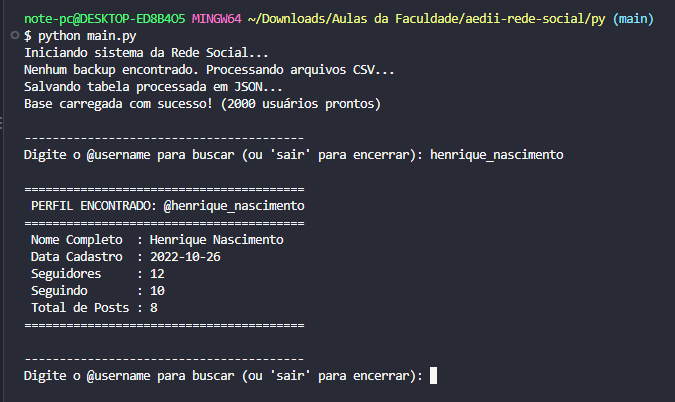
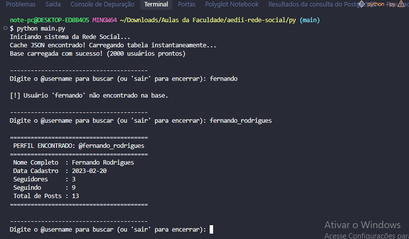
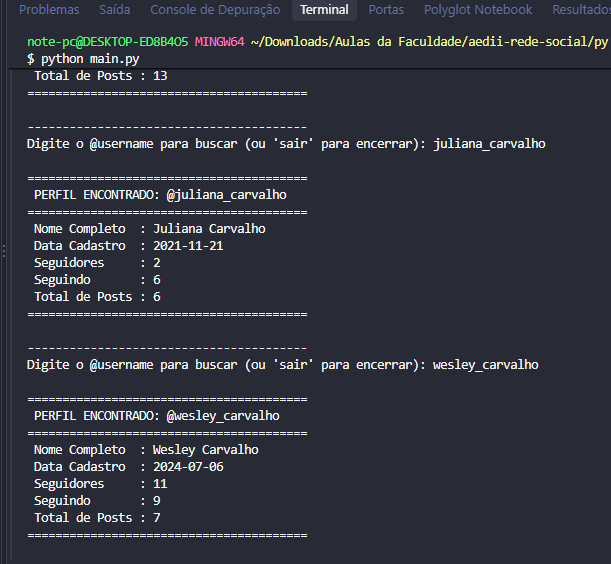
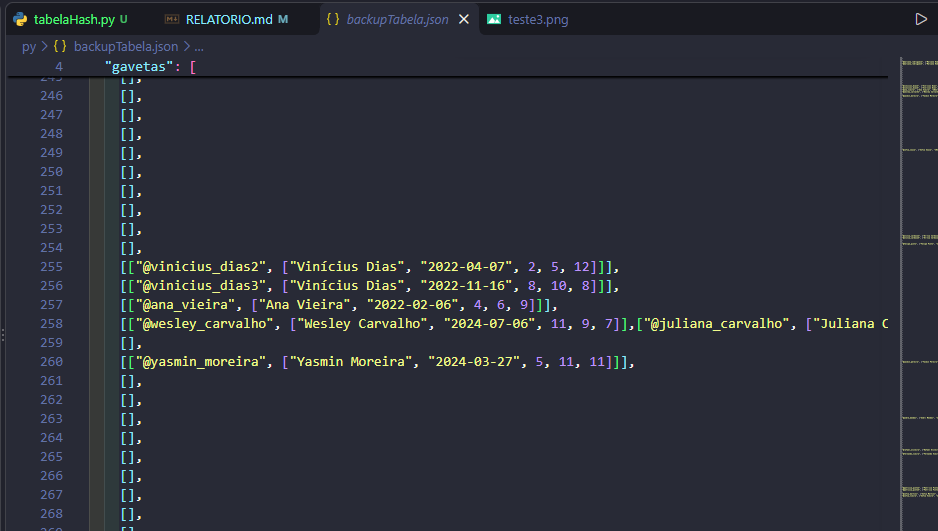
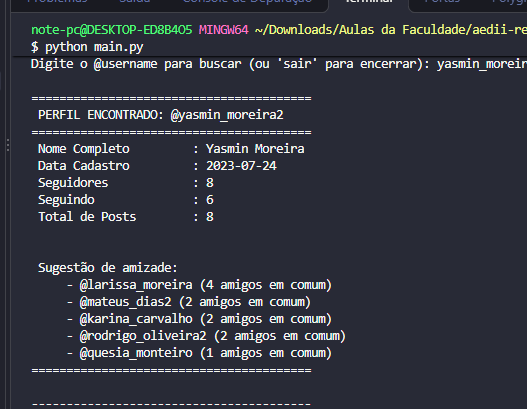

# Relatório

**Autores:** Dione e Ítalo

---

## Parte da tabela hash

### 1. O que foi feito

Criamos uma classe que recebe um tamanho baseado na quantidade de usuários, garantindo que ele seja **pelo menos 30% maior** que a quantidade original. Com isso, buscamos dar a cada usuário a sua própria linha na tabela hash (o que ainda não é totalmente garantido). Como o algoritmo usa **encadeamento separado**, dois usuários ainda podem cair na mesma linha, mas as informações de cada um ficam separadas, de modo que podem ser pesquisadas sem que uma afete a outra.

O cálculo que decide em qual linha cada usuário fica é baseado no **DJB2**, que usa deslocamento de bits para um cálculo mais rápido. No nosso código, o processo é:

1. Lê o nome de cada usuário na coluna `usuario`;
2. Separa as letras do nome;
3. Transforma cada letra em um número, multiplica por 33 e combina os resultados;
4. O valor final define a linha do usuário.

Ainda é possível haver mais de um usuário por linha, mas isso é difícil de acontecer.

Depois que a tabela é organizada, é gerado um arquivo JSON com os dados. A busca lê esses dados "crus" para utilizá-los em cálculos e na API.

### 2. Como foi feito

- **Estrutura:** as funções principais para criar a tabela hash ficam em um arquivo separado, `tabelaHash.py`, chamado pelo `aedlib` para organizar os dados. A classe é iniciada com um tamanho específico, guarda a quantidade de itens da tabela e monta o vetor de listas com as informações dos usuários.
- **Função hash (`função_hash`):** optamos pelo algoritmo DJB2. O cálculo começa com um valor inicial (2381) e, para cada letra do nome de usuário, multiplica o valor acumulado por 33 e soma o código da letra. Para que a multiplicação seja mais rápida, os bits são deslocados em 5 casas (o que equivale a multiplicar por 32) e o valor anterior é somado, completando o ×33. O resultado, ajustado ao tamanho da tabela (resto da divisão), é o número da linha onde as informações do usuário serão guardadas.
- **Inserção:** a função de inserir percorre cada informação espalhada pelos CSVs, relacionando-as pelos IDs que aparecem. Cada usuário é guardado como um par chave-valor: a chave é o nome de usuário e o valor é a lista com suas informações. Formato e exemplo:
  - `[@nome_de_usuario, [Nome, data_de_cadastro, seguidores, seguidos, posts, ID]]`
  - `[@pedrinho1, ["Pedrinho", "20/10/2020", 5, 10, 354, 4821]]`
- **Salvamento:** o tamanho, a quantidade de itens e a tabela (percorrida por um laço de repetição que lê cada linha) são guardados no `backupTabela.json` pela função `salvar_json`. O arquivo é criado na primeira vez em que o `main.py` é executado.
- **Reaproveitamento:** nas execuções seguintes, os dados são lidos direto do JSON, sem precisar criar a tabela hash do zero a cada consulta.
- **Busca:** a função de busca procura pelo nome de usuário e, se o "@" (arroba) for esquecido, ela o completa. Em seguida, usa o código hash para ir direto à linha do JSON onde ficam as informações do usuário. Como pode haver mais de um usuário na mesma linha, ela confere qual deles é o usuário buscado pelo nome de usuário.

### 3. Escolhas tomadas e por quê

- **Função hash DJB2 (Daniel J. Bernstein):** é uma das mais populares e simples. Basicamente multiplica o número de cada letra por 33 e combina os valores para selecionar a linha.
- **Encadeamento separado para colisões:** usuários podem ficar na mesma linha, mas ficam em listas diferentes dentro da mesma posição da tabela.
- **Tamanho 26003:** é o número primo mais próximo de 130% da quantidade de dados que temos, o que nos dá uma folga. Números compostos costumam deixar mais linhas vazias enquanto outras ficam superlotadas, já tamanhos primos tendem a distribuir melhor os dados entre as linhas.
- **JSON:** Só usei para carregar o arquivo, pesquisei como fazia para criar uma função para salvar as informações em um JSON até perceber que JSON não estáva proibido de usar, foi a melhor forma que eu encontrei para deixar a tabela organizada e funcional, a outra forma era usar os CSVs, que ia aumentar o tempo de carregamento.

### 4. Complexidade

| Operação | Complexidade | Justificativa |
|---|---|---|
| Busca | O(1) | Usa o código hash para ir direto à linha onde as informações estão (ou vão ficar). |
| Função hash | O(1) | Calcula a linha diretamente, sem percorrer a tabela. |
| Criação da tabela | O(n) | Passa linha por linha, mesmo as vazias, para gerar o JSON. Não é um problema, pois isso só precisa ser feito uma vez. |

### 5. Testes

#### Teste 1 — Primeira execução (criando o JSON do zero)

**Objetivo:** verificar a criação do `backupTabela.json` na primeira vez que o `main.py` é executado.

*Figura 1 — Primeira execução, com a criação do JSON do zero.*

#### Teste 2 — Segunda execução (usando o JSON pronto)

**Objetivo:** verificar que, nas execuções seguintes, os dados são carregados do JSON já existente.

*Figura 2 — Segunda execução, utilizando o JSON pronto.*

#### Teste 3 — Busca de usuários na mesma linha do JSON

**Objetivo:** verificar que usuários que caem na mesma linha continuam sendo pesquisados de forma independente.

*Figura 3 — Busca dos usuário que compartilham a mesma linha.*

*Figura 4 — mostra os usuários que compartilha a mesma linha no json.*

## Parte da pesquisa: Heap + Árvore

### 1. O que foi feito

Criamos uma classe chamada `MaxHeap` que retorna apenas o **ID do usuário recomendado** e a **quantidade de amigos em comum**. Depois da busca por um usuário, o fluxo é:

1. Pega cada usuário seguido por ele;
2. Olha os seguidos de cada um desses seguidos (seguidos dos seguidos), pela função `recomendacoes`;
3. Coloca os candidatos em uma lista de frequência (`contar_amigos_comuns`): cada candidato é comparado com os outros seguidos do usuário para ver quantas vezes aparece, e o número de ocorrências vira a sua pontuação de amigos em comum;
4. Insere todos os candidatos em uma árvore (`inserir`), onde a raiz é sempre o candidato com **mais amigos em comum**; ele é comparado com os demais candidatos, nos galhos e nas folhas, e as trocas necessárias são feitas (`subir` e `descer`);
5. Retira o candidato com mais amigos em comum da árvore (`remover_maior`) e o coloca em um vetor, que será apresentado na pesquisa. A árvore substitui o que acabou de sair por uma folha, que refaz as comparações, e o processo se repete até não sobrar mais ninguém;
6. Quando os cálculos terminam, o `main` envia tudo junto do resto da pesquisa do usuário, com os **nomes de usuário** e a **quantidade de seguidores "amigos" em comum**.

### 2. Como foi feito

#### Arquivos envolvidos

| Arquivo | Papel |
|---|---|
| `heap.py` | Contém a classe responsável pelas recomendações (`MaxHeap`). |
| `aedlib` | Chama o `heap.py` e recebe os pedidos do `main`. |
| `main` | Envia o resultado das recomendações junto da pesquisa do usuário. |
| `backupTabela.json` | Usado para trocar os IDs pelos nomes de usuário. |

#### Funções, na ordem em que acontecem

1. **`contar_amigos_comuns`:** antes de os dados serem enviados para a classe, eles passam por um contador que conta quantas vezes cada usuário se repete nos seguidos dos seguidos do usuário. Isso simula uma **BFS (Busca em Largura)**: primeiro olha os seguidos do usuário e depois os seguidos de cada um deles. O próprio usuário e quem ele já segue são ignorados.
2. **`inserir`:** os candidatos são colocados em um vetor de listas, onde cada lista tem o **ID do candidato** e **quantas vezes ele apareceu** nos seguidos dos seguidos.
3. **`subir`:** depois da inserção, o candidato com mais amigos em comum vai sendo colocado mais próximo da raiz da árvore (se não nela).
4. **`remover_maior`:** retira da árvore o candidato mais recomendado e o retorna para ser colocado em outra lista.
5. **`descer`:** a folha que ocupou o lugar do candidato retirado desce, sendo comparada com os demais, até a árvore voltar a ter quem tem mais amigos em comum no topo e quem tem menos mais abaixo. O processo repete até a lista terminar.

#### No `aedlib`

- **`recomendacoes`:** cria uma fila onde cada usuário é guardado em ordem, do mais recomendado para o menos recomendado.
- **Mapeamento de IDs:** até aqui os usuários recomendados eram tratados pelos IDs. Nesta etapa, os respectivos nomes de usuário são buscados no `backupTabela.json`, para melhor identificação no terminal ou na API. Exemplo: `1154` → `@yasmin_moreira2`.

### 3. Escolhas tomadas e por quê

- **BFS para os seguidos dos seguidos:** precisávamos apenas da 2ª camada inteira dos seguidos pelo usuário. Cada vez que o ID de um candidato se repete, ele ganha +1 ponto de frequência, que serve para marcar o mais recomendável com base em quem o usuário raiz já segue.
- **Max-heap:** queríamos saber quais eram os melhores candidatos, e o max-heap vai direto ao ponto: quem é mais frequente nas listas de seguidos dos seguidos fica no topo da árvore, sai, e a árvore é reorganizada para entregar os próximos melhores.
- **Resultado em fila:** o candidato que sai da árvore entra no vetor de recomendados, e os 5 primeiros são apresentados em ordem no terminal ou na API.

### 4. Complexidade

| Etapa | Complexidade | Justificativa |
|---|---|---|
| Busca (BFS) | O(n²) | Olha os seguidos do usuário e, depois, os seguidos de cada seguido dele, pela BFS. |
| Organização (max-heap) | O(n log n) | A árvore se organiza pela frequência de cada candidato nos seguidos dos outros e se reorganiza a cada saída. |

### 5. Testes

#### Teste 5 — Sugestões junto do usuário pesquisado

**Objetivo:** garantir que as sugestões apareçam junto do resultado da pesquisa do usuário.

*Figura 5 — Resultado da pesquisa com as recomendações.*